<div align="center">

<picture>
  <source media="(prefers-color-scheme: dark)" srcset="docs/art/banner-dark-en.svg">
  
</picture>

[](https://github.com/Sweax3169/sweaxmorph/releases/latest)
[](#install)
[](#every-format)
[](LICENSE)

[Website](https://sweax3169.github.io/sweaxmorph/) · [Türkçe](README.tr.md) · [Download](https://github.com/Sweax3169/sweaxmorph/releases/latest)

<picture>
  <source media="(prefers-color-scheme: dark)" srcset="docs/media/demo-dark-en.gif">
  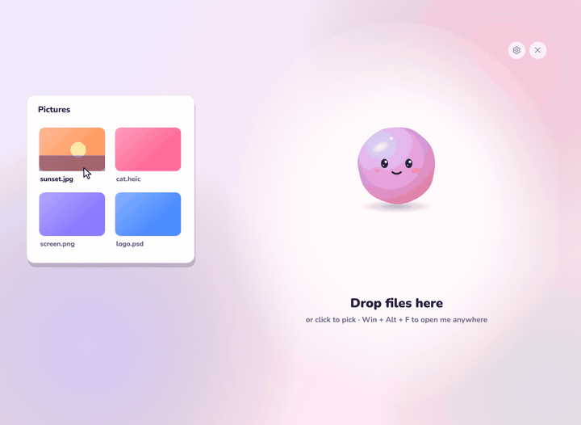
</picture>

</div>

## Meet Morph

Morph is a little gel creature that eats files. Carry a file near it and it opens its mouth; let go and it swallows the
file, takes on its colour, and grows a ring of petals: the formats that file can become. Pick one and Morph fills up
with liquid as it works, then pops out the result next to your original. Drag the result straight into a chat or an email.

<table>
<tr>
<td>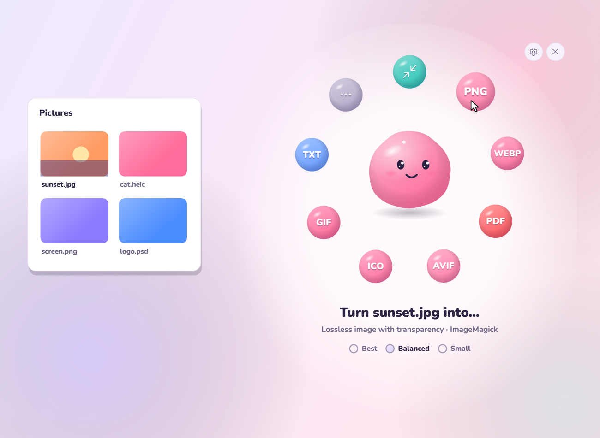</td>
<td>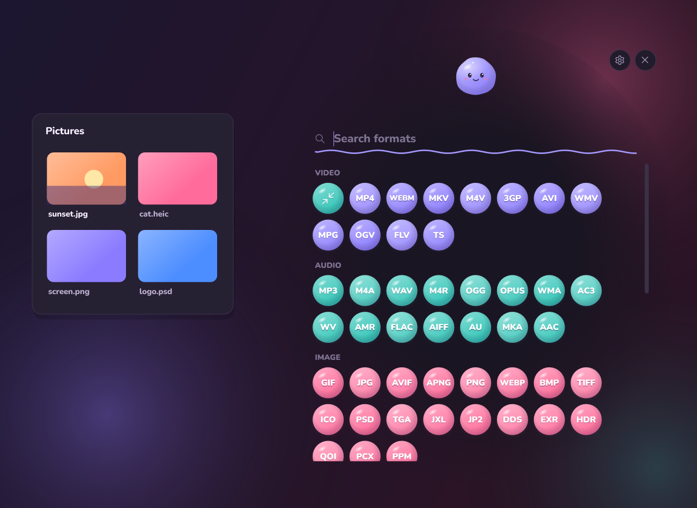</td>
</tr>
<tr>
<td align="center"><sub>Drop a photo: the formats it can become bloom around Morph</sub></td>
<td align="center"><sub><b>More</b> opens the whole garden. Just start typing a format's name</sub></td>
</tr>
</table>

## Three ways in

| | |
|---|---|
| <kbd>Win</kbd> + <kbd>Alt</kbd> + <kbd>F</kbd> | Opens Morph under your pointer, from anywhere. Change the shortcut in Settings, it records any combination. |
| <kbd>Space</kbd> while dragging | Start dragging files in Explorer, tap Space, and Morph pops up right under them. Drop on Morph, or straight on a petal. |
| Right-click → **Convert with SweaxMorph** | Also in **Send to**. Select ten files and they all arrive together. On Windows 11 it's under **Show more options**. |

## Every format

Images, video, audio, documents, spreadsheets, slides, PDF, e-books, data, archives, subtitles and fonts. Anything that
can be read can become anything it makes sense to become. Where no single tool can do it, SweaxMorph plans a route,
like PowerPoint → PDF → PNG, or Pages → DOCX → EPUB.

| Kind | Formats |
|---|---|
| **Image** | PNG · JPG · WEBP · AVIF · HEIC\* · GIF · BMP · TIFF · ICO · SVG · PSD · TGA · JXL · JP2 · DDS · EXR · HDR · QOI · PCX · PPM · EMF\* · CUR\* · RAW\* · XCF\* · APNG |
| **Video** | MP4 · MKV · WEBM · MOV · AVI · WMV · FLV · M4V · MPG · TS · 3GP · OGV |
| **Audio** | MP3 · WAV · FLAC · M4A · AAC · OGG · OPUS · WMA · AIFF · AC3 · M4R · MKA · WV · APE\* · AMR · AU · DTS\* |
| **Subtitles** | SRT · VTT · ASS · TTML · LRC · SUB\* |
| **Document** | DOCX · DOC · DOCM\* · ODT · RTF · TXT · MD · HTML · MHT · TEX · RST · ORG · ADOC · TEXTILE · WIKI · IPYNB · TYP · DOCBOOK · XPS · PAGES\* · WPD\* · PUB\* · VSDX\* · ODG · HWP\* |
| **Spreadsheet** | XLSX · XLS · XLSM\* · XLSB · ODS · CSV · TSV · NUMBERS\* |
| **Slides** | PPTX · PPT · PPSX · ODP · KEY\* |
| **PDF** | PDF |
| **E-book** | EPUB · MOBI · AZW3 · FB2 · CBZ · LIT\* |
| **Data** | JSON · YAML · TOML · XML · JSONL |
| **Archive** | ZIP · 7Z · RAR\* · TAR · TAR.GZ · TAR.BZ2\* · TAR.XZ\* · GZ\* · BZ2\* · XZ\* · ISO\* · CAB\* |
| **Font** | TTF · OTF · WOFF · WOFF2 |

<sub>\* read only: SweaxMorph opens these and turns them into something else.</sub>

### Small things that matter

<table>
<tr>
<td width="50%"><picture><source media="(prefers-color-scheme: dark)" srcset="docs/art/card-shrink-dark-en.svg"></picture></td>
<td width="50%"><picture><source media="(prefers-color-scheme: dark)" srcset="docs/art/card-combine-dark-en.svg"></picture></td>
</tr>
<tr>
<td width="50%"><picture><source media="(prefers-color-scheme: dark)" srcset="docs/art/card-route-dark-en.svg"></picture></td>
<td width="50%"><picture><source media="(prefers-color-scheme: dark)" srcset="docs/art/card-safe-dark-en.svg"></picture></td>
</tr>
<tr>
<td width="50%"><picture><source media="(prefers-color-scheme: dark)" srcset="docs/art/card-ocr-dark-en.svg"></picture></td>
<td width="50%"><picture><source media="(prefers-color-scheme: dark)" srcset="docs/art/card-fast-dark-en.svg"></picture></td>
</tr>
</table>

- **Shrink.** Every photo, video and song also gets a "Shrink" petal: the same format, much smaller.
- **Combine.** Drop many files and tick *Combine into one file*: photos → one PDF or animated GIF, PDFs → one merged PDF, clips → one video, anything → one ZIP.
- **Never overwrites.** Results land next to the original (or on the Desktop, or a folder you choose) as `name (2).ext` when the name is taken.
- **Fast when it can be.** MP4 → MKV copies the streams instead of re-encoding and takes a second. Office files go through Office itself when it's installed.
- **Scans become text.** Image → TXT and scanned PDF → TXT use the OCR built into Windows, in your languages.
- **Three qualities.** *Best* keeps everything, *Balanced* is the sensible default, *Small* is for sharing.

## Measured

All 103 conversions of the built-in self-test pass (`SweaxMorph.exe --selftest <folder>`). These are some of them, timed on an AMD Ryzen 5 7600 with 32 GB of RAM. The sample files are small on purpose, so the times mostly show what each engine costs to start.

| Conversion | Through | Time | Size |
|---|---|---:|---|
| `photo.png` → **WEBP** | ImageMagick | 189 ms | 90 KB → 20 KB |
| `photo.png` → **AVIF** | ImageMagick | 696 ms | 90 KB → 11 KB |
| `photo.png` → **ICO** | ImageMagick | 251 ms | 90 KB → 364 KB |
| `photo.png` → **TXT** | Windows OCR | 707 ms | 90 KB → 66 B |
| `clip.mp4` → **MKV** | FFmpeg | 341 ms | 433 KB → 430 KB |
| `clip.mp4` → **WEBM** | FFmpeg | 2.6 s | 433 KB → 490 KB |
| `clip.mp4` → **GIF** | FFmpeg | 2.1 s | 433 KB → 1.4 MB |
| `song.wav` → **MP3** | FFmpeg | 307 ms | 1.0 MB → 36 KB |
| `song.wav` → **MP4** | FFmpeg | 1.6 s | 1.0 MB → 171 KB |
| `notes.md` → **DOCX** | Pandoc | 195 ms | 408 B → 11 KB |
| `notes.md` → **PDF** | Pandoc → Edge | 2.8 s | 408 B → 72 KB |
| `letter.docx` → **PDF** | Word | 4.3 s | 11 KB → 92 KB |
| `deck.pptx` → **PNG** | PowerPoint | 1.1 s | 28 KB → 74 KB |
| `paper.pdf` → **DOCX** | LibreOffice | 10.3 s | 92 KB → 7.9 KB |
| `paper.pdf` → **TXT** | Windows PDF | 571 ms | 92 KB → 336 B |
| `table.csv` → **XLSX** | SweaxMorph | 18 ms | 131 B → 6.6 KB |
| `config.json` → **YAML** | SweaxMorph | 9 ms | 246 B → 202 B |
| `font.ttf` → **WOFF2** | SweaxMorph | 3.0 s | 1021 KB → 464 KB |
| `pack.zip` → **7Z** | SweaxMorph | 128 ms | 48 KB → 46 KB |

## How it works

Most conversions run inside SweaxMorph: images ([Magick.NET](https://github.com/dlemstra/Magick.NET)), PDF pages and OCR
(Windows), data and spreadsheets, archives, and web fonts (written from the WOFF/WOFF2 specs). The heavy engines are used
where they are best:

| Engine | Used for | How you get it |
|---|---|---|
| [FFmpeg](https://ffmpeg.org) | video, audio, subtitles | found on your PC, or downloaded once (~100 MB) the first time you need it |
| [Pandoc](https://pandoc.org) | Markdown, HTML, EPUB, LaTeX, Jupyter, wiki formats | downloaded once (~40 MB) when first needed |
| 7-Zip | creating .7z | downloaded once (600 KB) when first needed |
| Microsoft Office | Word, Excel, PowerPoint, slides → pictures and MP4 | used if installed (hidden, read-only, macros off) |
| [LibreOffice](https://www.libreoffice.org) | Pages, Numbers, Keynote, Visio, Publisher, WordPerfect…, PDF → Word, Office files without Office | used if installed |
| [Calibre](https://calibre-ebook.com) | Kindle MOBI and AZW3 | used if installed |
| Microsoft Edge | HTML and SVG → PDF | already on Windows |

Nothing is uploaded anywhere. The only network traffic is the one-time engine download, from the projects' official
releases.

## Install

1. Download **SweaxMorph-win-x64.zip** from [Releases](https://github.com/Sweax3169/sweaxmorph/releases/latest) and run `SweaxMorph.exe`.
2. It copies itself to `%LOCALAPPDATA%\Programs\SweaxMorph`, adds the right-click entry and starts with Windows. No admin rights needed.
3. Press <kbd>Win</kbd> + <kbd>Alt</kbd> + <kbd>F</kbd> and drop something on Morph.

Morph waits on top while you go and pick a file in Explorer; close it with its × button, <kbd>Esc</kbd> or the shortcut. Settings open from the gear on Morph's top-right or the tray icon's menu. To remove SweaxMorph, turn off the right-click entry and start-up in Settings, quit, and delete the folder.

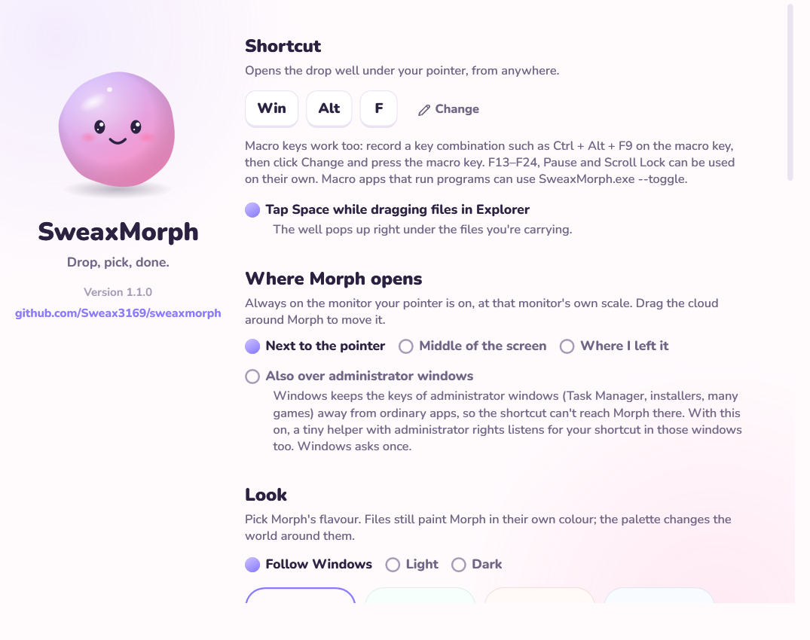

## Build

```bash
dotnet build src/SweaxMorph -c Release
```

.NET 9, WPF. `SweaxMorph.exe --selftest <folder>` makes sample files and runs about a hundred conversions,
writing a report; `--shots <folder>` renders the pictures and the recording in this README.

## Credits

Magick.NET · FFmpeg · Pandoc · SharpCompress · ClosedXML · ExcelDataReader · PdfPig · YamlDotNet · Tomlyn ·
Nunito by Vernon Adams (SIL Open Font License). See [THIRD_PARTY_NOTICES.md](THIRD_PARTY_NOTICES.md).

Made by [Sweax Studios](https://github.com/Sweax3169). MIT License.
