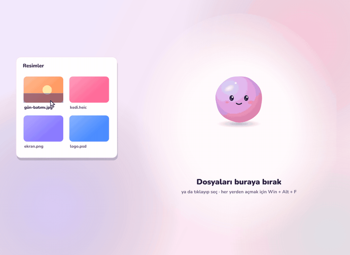
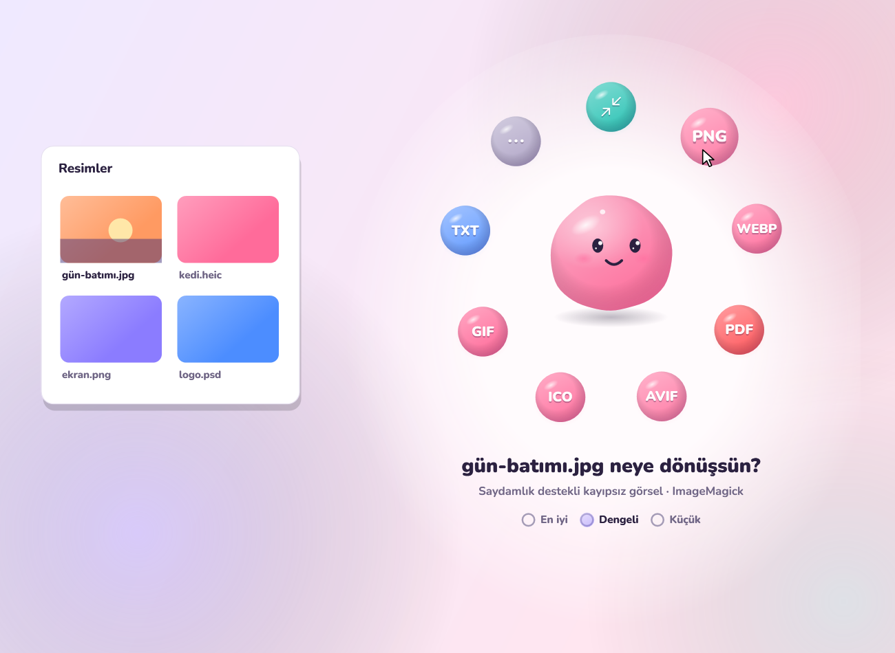
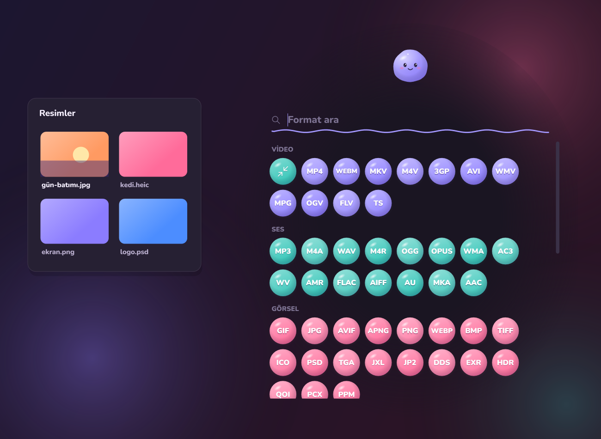
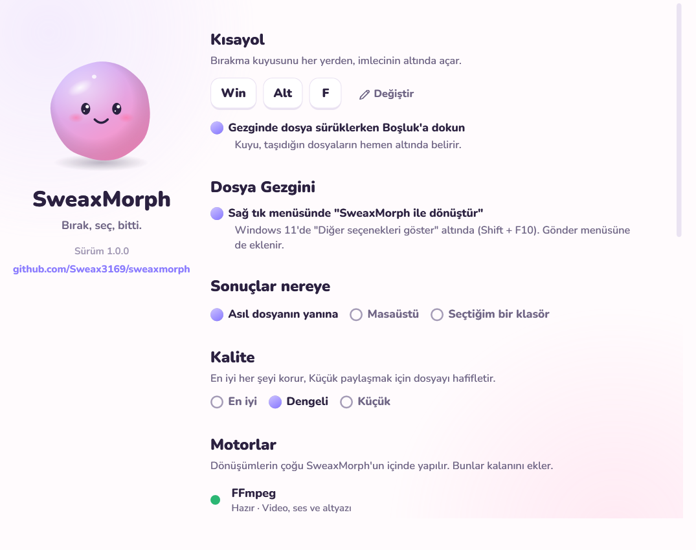

<div align="center">


# SweaxMorph

**Dosyayı Morph'a bırak. Formatı seç. Bitti.**

Windows 10 ve 11 için tek kısayol uzağında duran bir dosya dönüştürücü. <kbd>Win</kbd> + <kbd>Alt</kbd> + <kbd>F</kbd>'ye bas,
Gezgin'de dosya sürüklerken <kbd>Boşluk</kbd>'a dokun ya da dosyaya sağ tıkla.<br>126 format · 229 dosya uzantısı · 6.500'den fazla dönüşüm · çevrimdışı

[](https://github.com/Sweax3169/sweaxmorph/releases/latest)
[](#kurulum)
[](#her-format)
[](LICENSE)

[Web sitesi](https://sweax3169.github.io/sweaxmorph/) · [English](README.md) · [İndir](https://github.com/Sweax3169/sweaxmorph/releases/latest)

<picture>
  <source media="(prefers-color-scheme: dark)" srcset="docs/media/demo-dark-tr.gif">
  
</picture>

</div>

## Morph'la tanış

Morph, dosya yiyen küçük bir jöle yaratık. Bir dosyayı yanına getirdiğinde ağzını açar; bıraktığında dosyayı yutar,
onun rengini alır ve etrafında yapraklar açar: o dosyanın dönüşebileceği formatlar. Birini seçersin, Morph çalışırken
sıvıyla dolar ve sonucu asıl dosyanın yanına bırakır. Sonucu doğrudan bir sohbete ya da e-postaya sürükleyebilirsin.

<table>
<tr>
<td></td>
<td></td>
</tr>
<tr>
<td align="center"><sub>Bir fotoğraf bırak: dönüşebileceği formatlar Morph'un etrafında açılır</sub></td>
<td align="center"><sub><b>Daha fazla</b> tüm bahçeyi açar. Format adını yazmaya başlaman yeter</sub></td>
</tr>
</table>

## Üç giriş yolu

| | |
|---|---|
| <kbd>Win</kbd> + <kbd>Alt</kbd> + <kbd>F</kbd> | Morph'u her yerden, imlecinin altında açar. Kısayolu Ayarlar'dan değiştirebilirsin; istediğin tuş birleşimini kaydeder. |
| Sürüklerken <kbd>Boşluk</kbd> | Gezgin'de dosya sürüklemeye başla, Boşluk'a dokun; Morph tam dosyaların altında belirir. Morph'a ya da doğrudan bir yaprağa bırak. |
| Sağ tık → **SweaxMorph ile dönüştür** | **Gönder** menüsünde de var. On dosya seçersen hepsi birlikte gelir. Windows 11'de **Diğer seçenekleri göster** altında. |

## Her format

Görsel, video, ses, belge, tablo, sunu, PDF, e-kitap, veri, arşiv, altyazı ve yazı tipi. Okunabilen her şey, dönüşmesi
mantıklı olan her şeye dönüşebilir. Tek bir aracın yapamadığı yerde SweaxMorph bir yol planlar: PowerPoint → PDF → PNG ya da
Pages → DOCX → EPUB gibi.

| Tür | Formatlar |
|---|---|
| **Görsel** | PNG · JPG · WEBP · AVIF · HEIC\* · GIF · BMP · TIFF · ICO · SVG · PSD · TGA · JXL · JP2 · DDS · EXR · HDR · QOI · PCX · PPM · EMF\* · CUR\* · RAW\* · XCF\* · APNG |
| **Video** | MP4 · MKV · WEBM · MOV · AVI · WMV · FLV · M4V · MPG · TS · 3GP · OGV |
| **Ses** | MP3 · WAV · FLAC · M4A · AAC · OGG · OPUS · WMA · AIFF · AC3 · M4R · MKA · WV · APE\* · AMR · AU · DTS\* |
| **Altyazı** | SRT · VTT · ASS · TTML · LRC · SUB\* |
| **Belge** | DOCX · DOC · DOCM\* · ODT · RTF · TXT · MD · HTML · MHT · TEX · RST · ORG · ADOC · TEXTILE · WIKI · IPYNB · TYP · DOCBOOK · XPS · PAGES\* · WPD\* · PUB\* · VSDX\* · ODG · HWP\* |
| **Tablo** | XLSX · XLS · XLSM\* · XLSB · ODS · CSV · TSV · NUMBERS\* |
| **Sunu** | PPTX · PPT · PPSX · ODP · KEY\* |
| **PDF** | PDF |
| **E-kitap** | EPUB · MOBI · AZW3 · FB2 · CBZ · LIT\* |
| **Veri** | JSON · YAML · TOML · XML · JSONL |
| **Arşiv** | ZIP · 7Z · RAR\* · TAR · TAR.GZ · TAR.BZ2\* · TAR.XZ\* · GZ\* · BZ2\* · XZ\* · ISO\* · CAB\* |
| **Yazı tipi** | TTF · OTF · WOFF · WOFF2 |

<sub>\* yalnızca okunur: SweaxMorph bunları açıp başka bir şeye dönüştürür.</sub>

### Küçük ama önemli şeyler

- **Küçült.** Her fotoğraf, video ve şarkıya bir de "Küçült" yaprağı çıkar: aynı format, çok daha küçük.
- **Birleştir.** Birden çok dosya bırakıp *Tek dosyada birleştir*'i işaretle: fotoğraflar → tek PDF ya da hareketli GIF, PDF'ler → tek PDF, klipler → tek video, her şey → tek ZIP.
- **Asla üzerine yazmaz.** Sonuç asıl dosyanın yanına (ya da Masaüstüne, ya da seçtiğin klasöre) gider; ad doluysa `ad (2).uzantı` olur.
- **Olabildiğince hızlı.** MP4 → MKV yeniden kodlamak yerine akışları kopyalar, bir saniye sürer. Office kuruluysa Office dosyaları Office'in kendisiyle çevrilir.
- **Taramalar metne dönüşür.** Görsel → TXT ve taranmış PDF → TXT, Windows'un kendi yazı tanımasını senin dillerinde kullanır.
- **Üç kalite.** *En iyi* her şeyi korur, *Dengeli* akıllı varsayılandır, *Küçük* paylaşmak içindir.

## Nasıl çalışır

Dönüşümlerin çoğu SweaxMorph'un içinde yapılır: görseller ([Magick.NET](https://github.com/dlemstra/Magick.NET)), PDF sayfaları
ve yazı tanıma (Windows), veri ve tablolar, arşivler ve web yazı tipleri (WOFF/WOFF2 belirtimlerinden yazıldı). Ağır motorlar
en iyi oldukları yerde kullanılır:

| Motor | Ne için | Nasıl gelir |
|---|---|---|
| [FFmpeg](https://ffmpeg.org) | video, ses, altyazı | bilgisayarında varsa o, yoksa ilk gerektiğinde bir kez indirilir (~100 MB) |
| [Pandoc](https://pandoc.org) | Markdown, HTML, EPUB, LaTeX, Jupyter, wiki biçimleri | ilk gerektiğinde bir kez indirilir (~40 MB) |
| 7-Zip | .7z oluşturma | ilk gerektiğinde bir kez indirilir (600 KB) |
| Microsoft Office | Word, Excel, PowerPoint, slaytlar → MP4 | kuruluysa kullanılır (gizli, salt okunur, makrolar kapalı) |
| [LibreOffice](https://www.libreoffice.org) | Pages, Numbers, Keynote, Visio, Publisher, WordPerfect…, PDF → Word, Office olmadan Office dosyaları | kuruluysa kullanılır |
| [Calibre](https://calibre-ebook.com) | Kindle MOBI ve AZW3 | kuruluysa kullanılır |
| Microsoft Edge | HTML ve SVG → PDF | Windows'ta zaten var |

Hiçbir şey bir yere yüklenmez. Tek ağ trafiği, motorların projelerin resmi sürümlerinden bir kez indirilmesidir.

## Kurulum

1. [Sürümler](https://github.com/Sweax3169/sweaxmorph/releases/latest) sayfasından **SweaxMorph-win-x64.zip**'i indir ve `SweaxMorph.exe`'yi çalıştır.
2. Kendini `%LOCALAPPDATA%\Programs\SweaxMorph` içine kopyalar, sağ tık girişini ekler ve Windows ile başlar. Yönetici izni gerekmez.
3. <kbd>Win</kbd> + <kbd>Alt</kbd> + <kbd>F</kbd>'ye bas ve Morph'a bir şey bırak.

Ayarlar, tepsi simgesinin menüsünde. Kaldırmak için Ayarlar'dan sağ tık girişini ve başlangıçta açılmayı kapat, çık ve klasörü sil.



## Derleme

```bash
dotnet build src/SweaxMorph -c Release
```

.NET 9, WPF. `SweaxMorph.exe --selftest <klasör>` örnek dosyalar üretip yüz kadar dönüşüm yapar ve rapor yazar;
`--shots <klasör>` bu sayfadaki görselleri ve kaydı üretir.

## Teşekkürler

Magick.NET · FFmpeg · Pandoc · SharpCompress · ClosedXML · ExcelDataReader · PdfPig · YamlDotNet · Tomlyn ·
Nunito, Vernon Adams (SIL Open Font License). Ayrıntılar: [THIRD_PARTY_NOTICES.md](THIRD_PARTY_NOTICES.md).

[Sweax Studios](https://github.com/Sweax3169) yapımı. MIT Lisansı.
